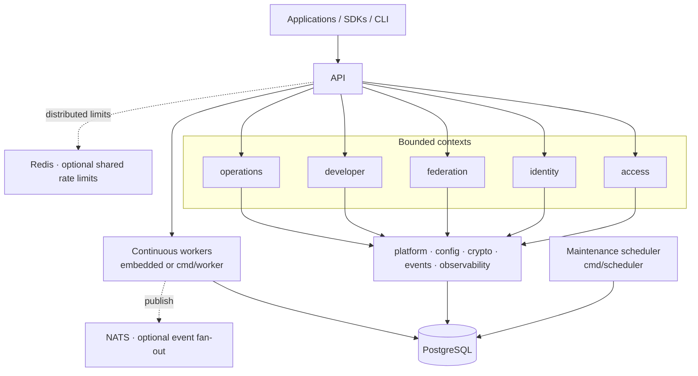

<div align="center">

# 🔐 Qeet ID

### Passkeys-first Identity & Access Platform

**A self-hostable Auth0 / Okta alternative for modern applications and enterprises.**

Own the identity layer, keep PostgreSQL as the source of truth, and deploy one Go API artifact.

[](https://github.com/qeetgroup/qeet-id-server/actions/workflows/ci.yml)
[](https://go.dev/)
[](https://www.postgresql.org/)
[](./api/openapi/)
[](./Dockerfile)
[](./LICENSE)

**[Website](https://id.qeet.in) &middot; [Documentation](https://docs.qeet.in) &middot; [API](./api/openapi/) &middot; [GitHub](https://github.com/qeetgroup/qeet-id-server) &middot; [Contributing](./CONTRIBUTING.md)**

</div>

---

## 🧭 What is Qeet ID?

Qeet ID is an open-source Identity and Access Management platform that combines authentication, authorization, enterprise federation, user lifecycle management, and machine identity behind one API. It is built for teams that need standards-based identity without handing control of users, credentials, and policy to a hosted identity vendor.

The backend is a Go modular monolith backed by PostgreSQL. Five bounded contexts share a small platform layer, while a composition root wires HTTP routes, policy enforcement, persistence, event delivery, and background work. The default API process runs as a single binary and embeds its continuous workers; dedicated worker and scheduler entrypoints are available when those workloads need to scale independently.

> [!IMPORTANT]
> Qeet ID is currently **pre-1.0**. Review the [changelog](./CHANGELOG.md) and [security policy](./SECURITY.md) before operating it in production.

## ✨ Key Features

| Area | Implemented capabilities |
| :--- | :--- |
| **Authentication** | WebAuthn/passkeys, passwords, email verification, magic links, MFA, session management |
| **Authorization** | RBAC, ABAC, ReBAC, tenant policies, explainable permission checks, AuthZEN evaluation API |
| **Identity** | Multi-tenant organizations, users, groups, invitations, imports, branding, email templates, DNS domain verification |
| **Federation** | OAuth 2.0/OpenID Connect, SAML 2.0, SCIM 2.0, LDAP/Active Directory, social login |
| **Developer & machine identity** | API keys, service principals, agent identities, verifiable credentials, secrets and token vaults, auth hooks, signed webhooks |
| **Operations** | Tamper-evident audit logs, analytics, GDPR workflows, retention jobs, SIEM sinks, notifications, rate limits, billing and entitlements |
| **AI** | Admin-console copilot backed by Anthropic or any OpenAI-compatible provider, plus a tool manifest for agent integrations |

Some capabilities are entitlement-gated, and external services such as social providers, SMS, email, Redis, NATS, KMS, AI providers, and payment processors require their own configuration.

### 🌐 Supported Standards

`WebAuthn` &middot; `OAuth 2.0` &middot; `OpenID Connect` &middot; `SAML 2.0` &middot; `SCIM 2.0` &middot; `AuthZEN` &middot; `JWT` &middot; `JWKS`

## 🏗️ Architecture

Qeet ID keeps domain boundaries explicit while retaining transactional consistency and a small operational footprint.



### Architecture Principles

- **Modular monolith** with explicit boundaries across five domain contexts.
- **PostgreSQL as the source of truth** with tenant-scoped persistence.
- **Single API artifact** with embedded workers and separate worker/scheduler entrypoints.
- **Transactional outbox** for durable events, with optional NATS fan-out.

### Repository layout

```text
cmd/          api · worker · scheduler · migrate · seed   (five entrypoints)
internal/
  bootstrap/  composition root — every dependency, route and worker is wired here
  access/     authentication · authorization · mfa · passkeys · recovery · risk · threat
  identity/   tenant · users · groups · invitations · verification · domainverify
  federation/ oidc · saml · scim · ldap · social · adminportal
  developer/  api-keys · principal · agents · webhooks · auth-hooks · credentials
  operations/ audit · billing · analytics · gdpr · retention · siem · notifications · qeetai · …
  platform/   config · crypto · database · http · events · jobs · messaging · observability · ai · cache
api/          openapi (five specs) · postman · qeetai (AI tool manifest)
tests/        architecture · integration · performance · security · fixtures
docs/llm/     architecture documentation for coding agents
```

Two boundary rules are enforced by [tests/architecture](./tests/architecture/) and fail CI:
`internal/platform/*` must not import a bounded context, `cmd/*` or `internal/bootstrap`; and a
bounded context must not import `cmd/*` or `internal/bootstrap`.

## 🧰 Technology Stack

| Layer | Technology |
| :--- | :--- |
| Language | Go 1.25 |
| HTTP | chi v5, REST, OpenAPI 3.1 |
| Database | PostgreSQL 16, pgx v5, SQL/sqlc |
| Authentication | WebAuthn/FIDO2, OAuth 2.0, OpenID Connect, SAML 2.0, SCIM 2.0 |
| Tokens & cryptography | ES256 JWT, JWKS, Argon2id, AES-GCM, HMAC-SHA256 |
| Events | PostgreSQL transactional outbox, optional NATS |
| Rate limiting | In-process token buckets, optional Redis |
| Observability | Prometheus metrics, OpenTelemetry tracing, structured logs |
| Testing | Go test, Testcontainers, k6, CodeQL, govulncheck |
| Container | Multi-stage Docker build, distroless non-root runtime |

## 🚀 Quick start

**You need:** Go 1.25 or newer &middot; Docker (with Compose) &middot; `make` &middot; `openssl`

```bash
git clone https://github.com/qeetgroup/qeet-id-server.git
cd qeet-id-server
make install

cp .env.example .env

make db-up    # postgres :5001 · nats :4222 · mailpit :8025
make dev      # generates .secrets/, applies migrations, serves http://localhost:4001
```

`make dev` runs in the foreground. Open a second shell and check it came up:

```bash
curl localhost:4001/healthz
curl localhost:4001/readyz
make seed     # demo tenants, users, API keys, OIDC clients
```

That is the whole setup. Everything else on this page is reference.

### What just happened

- **`make install`** is `go mod download`. Nothing more.
- **`.env`** carries your local configuration. The `<password>` placeholder must become `password`
  to match the Postgres container in [docker-compose.yml](./docker-compose.yml); the `perl` line
  above does it, or edit `DB_URL` by hand. Every other development default works as shipped.
- **`make db-up`** starts PostgreSQL 16 on `:5001`, NATS on `:4222` and Mailpit on `:8025`. The
  application itself runs on your host, not in Compose.
- **`make dev`** first runs `make dev-secrets`, generating a persistent ES256 JWT signing key and a
  SAML IdP key/certificate pair into `.secrets/` (gitignored, idempotent — it skips whatever already
  exists). It then starts the API, which **applies database migrations on startup**. There is no
  separate migrate step to remember.
- **`make seed`** loads fictional, production-shaped demo data: several workspaces, users across
  every role, API keys, OIDC clients, a SCIM token, service accounts, vault secrets and more. **It
  prints every credential it creates — read its output**, that is your login reference for the
  admin console.

### Useful endpoints

| URL | What |
| :--- | :--- |
| `http://localhost:4001/healthz` &middot; `/readyz` | Liveness and readiness |
| `http://localhost:4001/metrics` | Prometheus scrape endpoint |
| `http://localhost:4001/.well-known/openid-configuration` | OIDC discovery |
| `http://localhost:4001/.well-known/jwks.json` | Public signing keys |
| `http://localhost:8025` | Mailpit — read every message the app sends |

Mailpit only catches mail once you point the app at it. `.env.example` ships `SMTP_HOST` blank,
which makes the app **log** emails instead of sending them. To capture them in Mailpit, set
`SMTP_HOST=localhost` and `SMTP_PORT=1025` in `.env` and restart.

### If something goes wrong

| Symptom | Cause |
| :--- | :--- |
| Connection refused or password auth failure at startup | `<password>` is still literal in `.env` |
| Your `.env` edits appear to be ignored | You ran `go run ./cmd/api` directly. **Only the `Makefile` loads `.env`** — nothing in the Go code does, so a direct `go run` silently uses built-in defaults. Use `make dev` |
| `address already in use` on `:4001` | `make kill` frees the port |
| A passkey ceremony fails with `passkey.attestation_invalid` | The browser origin is missing from `WEBAUTHN_RP_ORIGINS`. CORS being correct is not enough |
| You want a clean slate | `make db-reset` (drops the volume), then `make dev`, then `make seed` |

## 🛠️ Development

Every target in the [Makefile](./Makefile) — there are no others.

| Command | Purpose |
| :--- | :--- |
| `make install` | `go mod download` |
| `make dev` | Run the API on `:4001` with persistent keys from `.secrets/` |
| `make dev-secrets` | Generate the local JWT and SAML key material only |
| `make build` | Compile the API to `bin/qeet-id` |
| `make test` | Run unit and architecture fitness tests |
| `make test-integration` | Run integration flows against Testcontainers PostgreSQL; Docker required |
| `make lint` | Run `go vet ./...` |
| `make bench` | Run k6 discovery and authorization checks; needs `make db-up seed dev` first |
| `make db-up` / `db-down` | Start or stop PostgreSQL, NATS and Mailpit |
| `make db-reset` | Recreate the local database volume |
| `make migrate-up` / `migrate-down` | Apply or roll back one migration; needs the `migrate` CLI |
| `make seed` / `seed-reset` | Load, or destructively reload, development demo data |
| `make kill` | Free a stuck `:4001` |

Run a single test with `go test ./internal/access/authentication/... -run TestName`.

Before opening a pull request:

```bash
go build ./... && go test -race ./... && make lint
make test-integration      # if the change touched a route
```

CI adds race detection, `golangci-lint` on changed code, integration tests, `govulncheck`, and
CodeQL analysis.

> [!NOTE]
> **`make lint` is `go vet` only.** CI additionally runs `golangci-lint` v2.12.2 against new and
> changed code. A clean local lint does not guarantee a green CI lint.

## 📚 API & Documentation

- [api/openapi/](./api/openapi/) holds five self-contained, bounded-context OpenAPI 3.1 documents —
  `auth.yaml` (access), `management.yaml` (identity), `federation.yaml`, `developer.yaml` and
  `operations.yaml`. There is no monolithic `openapi.yaml`; merge them with
  `go run ./tools/openapi-split merge`.
- **A route added without a matching specification entry fails CI** — `tests/integration/coverage_test.go`
  asserts every mounted route is documented. Update the spec in the same change as the route.
- [api/postman/](./api/postman/) provides an importable collection and environment.
- [Documentation](https://docs.qeet.in) covers product concepts and integration guidance.

## 🧠 Working in this repository

| File | For |
| :--- | :--- |
| [AGENTS.md](./AGENTS.md) | The rules, the commands, and what CI enforces — start here |
| [docs/llm/architecture-map.md](./docs/llm/architecture-map.md) | "Where is X?" answered in one hop |
| [docs/llm/context.md](./docs/llm/context.md) | How the backend actually works |
| [qeet-repo.yml](./qeet-repo.yml) | Machine-readable repository identity |
| [ROADMAP.md](./ROADMAP.md) | Shipped versus planned |

Three things reliably surprise newcomers:

1. **Tenant scope comes from the authenticated principal**, via `httpx.RequireTenant(r)` — never
   from a path, body, query or header. There is no PostgreSQL row-level security, so a missing
   `WHERE tenant_id = $1` is a cross-tenant data exposure rather than an error the database catches.
2. **Migrations are immutable once applied.** Add a new `.up.sql`/`.down.sql` pair; never edit an
   existing one.
3. **Two behaviours look like bugs and are deliberate**, each with an ADR: the rate limiter fails
   *open* when its store errors, and auth hooks default to *fail-open*.

## 📦 Deployment

The included [Dockerfile](./Dockerfile) builds the API as a distroless, non-root image.
[Docker Compose](./docker-compose.yml) is intentionally a local dependency stack; it does not
package the application.

The [deployment workflow](./.github/workflows/deploy.yml) runs on every push to `main`: it builds
and pushes the image to AWS ECR, rolls the configured host through AWS Systems Manager, then tags
and releases the new version only after the roll succeeds. Production configuration must provide
durable signing keys, explicit origins, TLS termination, and external secrets. Helm, Kubernetes, and
Terraform assets are not shipped in this repository.

## 🛡️ Security

Qeet ID validates production configuration at startup and refuses development-only CSRF,
trusted-header, origin, URL, sandbox-payment, or ephemeral-key settings outside the development
environment.

- Passwords and credential secrets use Argon2id, with transparent verification and upgrade of legacy bcrypt hashes.
- Passkeys use `go-webauthn`; access and ID tokens use ES256 with `kid`-based JWKS verification and retired-key support.
- The secrets vault uses AES-GCM with a static key or AWS KMS-backed data-key provider.
- Tenant routes are checked against the authenticated principal and persistence queries carry tenant scope.
- Audit events are transactionally recorded in per-tenant SHA-256 hash chains; webhooks use HMAC-SHA256 signatures.
- CSRF/origin checks, security headers, login lockout, and per-IP/principal/tenant rate limits provide request-layer defenses.

Report vulnerabilities privately according to [SECURITY.md](./SECURITY.md). Please do not open a public issue for a suspected vulnerability.

## 🤝 Contributing

Contributions are welcome. Pull requests target `develop`. Behavior changes need tests, API changes
must update [api/openapi](./api/openapi/), and schema changes must add immutable `.up.sql` and
`.down.sql` migrations. See [CONTRIBUTING.md](./CONTRIBUTING.md) and the
[Code of Conduct](./CODE_OF_CONDUCT.md) for the complete workflow.

## 📄 License

Qeet ID is available under the [MIT License](./LICENSE).

---

<div align="center">

**🔐 Identity infrastructure you control.**

[Qeet ID](https://id.qeet.in) &middot; Open Source &middot; Self-Hostable &middot; Developer First

</div>
